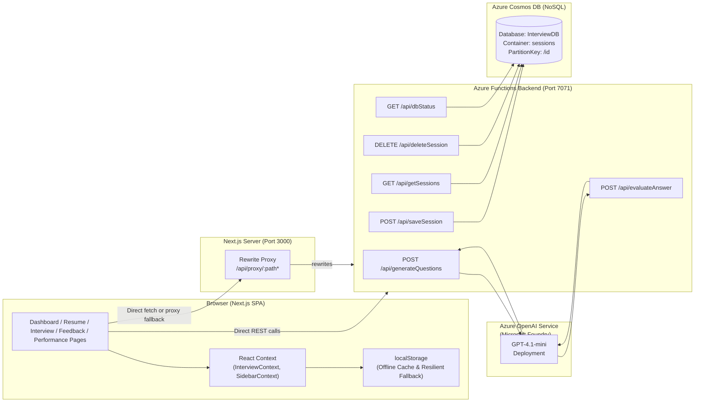
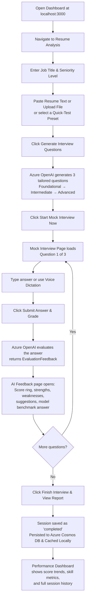

# AI Interview Preparation Platform

> **InterviewIQ** — Sharpen your technical interview skills with AI-generated questions, real-time mock sessions, and in-depth GPT-4.1-mini powered evaluations, all delivered through a premium dark-themed SaaS dashboard.

---


---

## Table of Contents

1. [Project Overview](#1-project-overview)
2. [Key Features](#2-key-features)
3. [Screenshots](#3-screenshots)
4. [Technology Stack](#4-technology-stack)
5. [System Architecture](#5-system-architecture)
6. [Project Folder Structure](#6-project-folder-structure)
7. [Installation and Setup](#7-installation-and-setup)
8. [Environment Configuration](#8-environment-configuration)
9. [Running the Application](#9-running-the-application)
10. [API Documentation](#10-api-documentation)
11. [Application Workflow](#11-application-workflow)
12. [Azure AI Integration](#12-azure-ai-integration)
13. [Security Considerations](#13-security-considerations)
14. [Troubleshooting](#14-troubleshooting)
15. [Viva & Project Defense Guide](#15-viva--project-defense-guide)
16. [Future Enhancements](#16-future-enhancements)
17. [Contributing](#17-contributing)
18. [License and Attribution](#18-license-and-attribution)
19. [Author](#19-author)

---

## 1. Project Overview

The **AI Interview Preparation Platform** (branded **InterviewIQ**) is a full-stack web application that helps software engineering candidates prepare for technical interviews using real AI.

### What it does

- Accepts a candidate's resume text or a quick-start preset.
- Sends the resume to an Azure Functions backend, which forwards it to **Microsoft Azure OpenAI Service** (GPT-4.1-mini via Microsoft Foundry).
- Returns **three tailored technical interview questions** ranked by difficulty (Foundational → Intermediate → Advanced).
- Hosts a **mock interview session** where candidates answer each question via typed text or browser voice dictation.
- Submits each answer back to Azure OpenAI for comprehensive evaluation, returning a scored feedback report with strengths, weaknesses, improvement suggestions, and a model benchmark answer.
- Tracks all sessions persistently in **Azure Cosmos DB** (NoSQL document database) with dual-tier synchronization and browser `localStorage` offline fallback, aggregating performance metrics on a dedicated Performance dashboard.

### The problem it solves

Technical interview preparation is typically expensive (coaching sessions), generic (LeetCode-style questions unrelated to your actual experience), or unstructured (no feedback loop). This platform bridges that gap by generating questions _from your own resume_ and scoring _your own answers_ — turning preparation into a personalized feedback loop.

### Why AI-powered preparation matters

- Questions are grounded in the candidate's real technology stack, not generic patterns.
- AI feedback is immediate, detailed, and consistent — no waiting for a human coach.
- The evaluation covers technical accuracy, communication style, relevance, and provides an example answer to study.

---

## 2. Key Features

| Feature | Status | Description |
|---|---|---|
| Interactive Dashboard | ✅ Implemented | KPI cards, quick launch, preparation progress, recent activity |
| Resume Analysis | ✅ Implemented | Upload or paste resume; select job title and seniority level |
| AI-Generated Questions | ✅ Implemented | 3 tailored technical questions per session via Azure OpenAI |
| Mock Interview | ✅ Implemented | Per-question answer editor with word/char count and voice dictation |
| AI Answer Evaluation | ✅ Implemented | Full scorecard: score, relevance, tone, accuracy, strengths/weaknesses |
| Detailed AI Feedback | ✅ Implemented | Model benchmark answer, suggestions, and raw feedback stream |
| Azure Cosmos DB Storage | ✅ Implemented | Cloud-native JSON document store (`interviewDB/sessions`) with live sync |
| Dual-Tier Persistence | ✅ Implemented | Instant local caching + asynchronous cloud database background sync |
| Performance Dashboard | ✅ Implemented | Score progression, skill metrics, full session history table |
| Interview History & Export | ✅ Implemented | Cloud-synchronized history with JSON data export and deletion |
| User Profile | ✅ Implemented | Compact profile modal (name, role, AI model, application) |
| Dark Theme | ✅ Implemented | Permanent dark navy theme throughout the application |
| Collapsible Sidebar | ✅ Implemented | Icon-only collapsed mode with tooltips, responsive mobile drawer |
| Dynamic Notifications | ✅ Implemented | Real-time bell badge driven by active session and evaluation state |
| Voice Dictation | ✅ Implemented | Web Speech API integration for microphone-based answers |
| Resume Presets | ✅ Implemented | Three one-click resume templates for instant testing |

---

## 3. Screenshots

> **Note:** Add actual screenshots to `docs/screenshots/` and update the paths below.

### Dashboard

```
docs/screenshots/dashboard.png
```

Replace with: ``

### Resume Analysis

```
docs/screenshots/resume-analysis.png
```

Replace with: ``

### Mock Interview

```
docs/screenshots/mock-interview.png
```

Replace with: ``

### AI Feedback

```
docs/screenshots/ai-feedback.png
```

Replace with: ``

### Performance Dashboard

```
docs/screenshots/performance.png
```

Replace with: ``

---

## 4. Technology Stack

### Frontend

| Technology | Version | Purpose |
|---|---|---|
| [Next.js](https://nextjs.org/) | 16.4.6 | React framework with App Router and Turbopack |
| [React](https://react.dev/) | 19.3.0 | UI rendering and component model |
| TypeScript | ^5 | Static typing throughout the frontend |
| [Tailwind CSS](https://tailwindcss.com/) | 4.3.3 | Utility-first CSS framework |
| @tailwindcss/turbopack | 4.3.3 | Tailwind loader for Turbopack dev server |
| [Lucide React](https://lucide.dev/) | ^1.73.0 | Icon library |
| Geist Font | via `next/font` | Sans-serif and mono typefaces |
| Web Speech API | Browser built-in | Voice dictation during mock interview |

### Backend & Database (Azure Serverless)

| Technology | Purpose |
|---|---|
| Azure Functions (v4 Node.js) | Serverless HTTP trigger REST API backend |
| Azure Cosmos DB (NoSQL API) | Cloud-native JSON document store for session history & scores |
| Microsoft Azure OpenAI Service | LLM inference endpoint |
| GPT-4.1-mini (via Microsoft Foundry) | Question generation and answer evaluation model |
| `@azure/cosmos` (v4.x) | Official Azure Cosmos DB Node.js SDK |
| `axios` & `dotenv` | HTTP client for Azure OpenAI calls & local env loading |

### Developer Tools & Orchestration

| Tool | Purpose |
|---|---|
| Azure Functions Core Tools (`func` v4) | Local Azure Functions runtime |
| `concurrently` | Single-command root runner for backend and frontend |
| ESLint + eslint-config-next | Linting |
| `@types/node`, `@types/react`, `@types/react-dom` | TypeScript type definitions |

---

## 5. System Architecture

### High-Level Overview

The frontend is a Next.js application running in the browser. It communicates with the Azure Functions backend over HTTP. The backend holds all AI credentials and proxies requests to the Azure OpenAI endpoint.



### Request Flow & Data Persistence

1. **Question Generation:** User submits resume text and target job role $\rightarrow$ `POST /api/generateQuestions` forwards to Azure OpenAI (GPT-4.1-mini) $\rightarrow$ Returns 3 tailored technical questions categorized by seniority and difficulty.
2. **Session Persistence:** Next.js starts a mock session $\rightarrow$ asynchronously calls `POST /api/saveSession` $\rightarrow$ Azure Functions upserts the session JSON document into **Azure Cosmos DB** (container: `sessions`, partition key `/id`). `localStorage` is maintained simultaneously as an offline fallback.
3. **Mock Evaluation:** Each candidate answer triggers `POST /api/evaluateAnswer` $\rightarrow$ GPT-4.1-mini evaluates relevance, accuracy, and tone, returning a score, feedback report, and model benchmark answer.
4. **Historical Synchronization:** The Dashboard and Performance pages call `GET /api/getSessions` to fetch stored interview sessions from Azure Cosmos DB, calculating aggregated skill metrics, score progression, and interview history across sessions.
5. **Session Management:** Users can delete past sessions via `DELETE /api/deleteSession?id=...`, which permanently purges the document from Cosmos DB.

---

## 6. Project Folder Structure

```
Mock-Interview-System/               ← Project root (Azure Serverless & Next.js Monorepo)
│
├── evaluateAnswer/                  ← Azure Function: evaluates interview answers via GPT-4.1-mini
│   ├── function.json                ← HTTP trigger definition [POST]
│   └── index.js                     ← Evaluation logic, scorecard extraction, prompt template
│
├── generateQuestions/               ← Azure Function: generates 3 tailored technical questions
│   ├── function.json                ← HTTP trigger definition [POST]
│   └── index.js                     ← Resume parsing & OpenAI prompt execution
│
├── saveSession/                     ← Azure Function: persists session JSON to Azure Cosmos DB
│   ├── function.json                ← HTTP trigger definition [POST]
│   └── index.js                     ← Cosmos DB upsert handler
│
├── getSessions/                     ← Azure Function: retrieves all sessions from Cosmos DB
│   ├── function.json                ← HTTP trigger definition [GET]
│   └── index.js                     ← Cosmos DB query handler
│
├── deleteSession/                   ← Azure Function: deletes an interview session
│   ├── function.json                ← HTTP trigger definition [DELETE, POST]
│   └── index.js                     ← Cosmos DB item deletion handler
│
├── dbStatus/                        ← Azure Function: checks Cosmos DB connectivity health
│   ├── function.json                ← HTTP trigger definition [GET]
│   └── index.js                     ← Health status provider
│
├── shared/                          ← Shared backend utilities
│   └── cosmosClient.js              ← Azure Cosmos DB SDK singleton & query helpers
│
├── host.json                        ← Azure Functions host settings & extension bundles
├── local.settings.json              ← Backend secrets (Cosmos DB, OpenAI API keys)
├── package.json                     ← Backend dependencies & concurrent dev orchestration
│
├── frontend/                        ← Next.js frontend application
│   ├── public/                      ← Static assets, SVGs, favicon
│   ├── src/
│   │   ├── app/                     ← Next.js App Router (Dashboard, Resume, Interview, Feedback, Performance)
│   │   ├── components/              ← Reusable UI & Layout components (AppLayout, Sidebar, Header, Badges)
│   │   ├── context/                 ← React Contexts (InterviewContext, SidebarContext)
│   │   ├── lib/                     ← API client (api.ts), Storage cache (storage.ts), Utils (utils.ts)
│   │   └── types/                   ← TypeScript interfaces (InterviewSession, EvaluationFeedback)
│   ├── .env.local                   ← Frontend environment config (NEXT_PUBLIC_API_BASE_URL)
│   ├── next.config.ts               ← Next.js config with rewrite proxy
│   └── package.json                 ← Frontend dependencies & scripts
│
└── README.md                        ← Full technical documentation
```

---

## 7. Installation and Setup

### Prerequisites

Install the following tools before proceeding:

| Tool | Download | Notes |
|---|---|---|
| Node.js | https://nodejs.org/ | v18, v20, or v22 LTS (v24 supported) |
| npm | Included with Node.js | v9+ |
| Azure Functions Core Tools | https://learn.microsoft.com/en-us/azure/azure-functions/functions-run-local | v4 for running serverless functions locally |
| Azure OpenAI Resource | https://portal.azure.com/ | Deployed model endpoint (GPT-4.1-mini) |
| Azure Cosmos DB Account | https://portal.azure.com/ | Azure Cosmos DB for NoSQL (or emulator) |

### 1. Clone the Repository

```bash
git clone https://github.com/YOUR_USERNAME/Mock-Interview-System.git
cd Mock-Interview-System
```

### 2. Install Dependencies

You can install all dependencies across both backend and frontend:

```bash
# 1. Install root backend dependencies (Cosmos DB SDK, Axios, Concurrently)
npm install

# 2. Install frontend dependencies (Next.js, React, Tailwind, Lucide)
cd frontend
npm install
cd ..
```

---

## 8. Environment Configuration

### Frontend — `frontend/.env.local`

The frontend requires one environment variable pointing to the Azure Functions API:

```env
# Point this to your Azure Functions instance
# Local development default:
NEXT_PUBLIC_API_BASE_URL=http://localhost:7071
```

### Backend — `local.settings.json`

The Azure Functions backend requires a `local.settings.json` file in the root folder:

```json
{
  "IsEncrypted": false,
  "Values": {
    "AzureWebJobsStorage": "",
    "FUNCTIONS_WORKER_RUNTIME": "node",
    "AZURE_OPENAI_API_KEY": "your_azure_openai_api_key",
    "AZURE_OPENAI_ENDPOINT": "https://your-resource.openai.azure.com/",
    "AZURE_OPENAI_DEPLOYMENT_ID": "gpt-4.1-mini",
    "AZURE_OPENAI_API_VERSION": "2024-10-21",
    "COSMOS_DB_CONNECTION_STRING": "AccountEndpoint=https://...;AccountKey=...;",
    "COSMOS_DB_DATABASE_NAME": "InterviewDB",
    "COSMOS_DB_CONTAINER_NAME": "sessions"
  }
}
```

> [!TIP]
> **Graceful Fallback:** If `COSMOS_DB_CONNECTION_STRING` is left blank during initial testing, the application automatically falls back to browser `localStorage` caching so you can test the AI mock interviews immediately before creating your Azure database!

---

## 9. Running the Application

### Option A: Single Command (Recommended)

Run both the **Azure Functions Backend** and the **Next.js Frontend** simultaneously from the project root:

```bash
npm run dev
```
*(or `npm start`)*

This starts:
- **Azure Functions Backend** (`func start`) on `http://localhost:7071`
- **Next.js Frontend** (`next dev`) on `http://localhost:3000`
- Color-coded logs from both services piped into one terminal.

### Option B: Separate Terminals

#### Terminal 1 — Start Azure Functions Backend
```bash
func start
```

#### Terminal 2 — Start Next.js Frontend
```bash
cd frontend
npm run dev
```

Open your browser at: **[http://localhost:3000](http://localhost:3000)**

### Production Build

To verify and produce an optimized production build:

```bash
cd frontend
npm run build
```

---

## 10. API Documentation

The Azure Functions backend exposes two HTTP POST endpoints.

---

### `POST /api/generateQuestions`

Generates three tailored technical interview questions based on a resume and job title.

**Request**

```http
POST http://localhost:7071/api/generateQuestions
Content-Type: application/json
```

```json
{
  "resumeText": "Target Job Title: Senior Azure Python Developer (Mid-Senior Level)\n\nCandidate Resume / Experience:\nSenior Backend Developer with 5 years experience specializing in Python, FastAPI, and Azure Functions..."
}
```

| Field | Type | Required | Description |
|---|---|---|---|
| `resumeText` | `string` | Yes | Combined prompt containing job title, seniority, and resume content |

**Success Response** — `200 OK`

```json
{
  "questions": [
    "How would you design a scalable Python-based microservice using Azure Functions and Cosmos DB to handle unpredictable API traffic?",
    "Explain your approach to implementing distributed tracing in a FastAPI service deployed on Azure Container Apps.",
    "What strategies would you use to optimize cold-start latency in Azure Functions running Python workloads?"
  ]
}
```

**Error Response** — `400 / 500`

```json
{
  "error": "Description of the error"
}
```

---

### `POST /api/evaluateAnswer`

Submits a candidate's answer to a technical question and returns a comprehensive AI evaluation.

**Request**

```http
POST http://localhost:7071/api/evaluateAnswer
Content-Type: application/json
```

```json
{
  "question": "How would you design a scalable serverless architecture on Azure using Azure Functions and Cosmos DB to handle unpredictable traffic spikes?",
  "answer": "I would use Azure Functions with a consumption plan to auto-scale based on demand. Cosmos DB with autoscale RUs would handle the data layer..."
}
```

| Field | Type | Required | Description |
|---|---|---|---|
| `question` | `string` | Yes | The interview question text |
| `answer` | `string` | Yes | The candidate's answer text |

**Success Response** — `200 OK`

```json
{
  "feedback": {
    "score": "7.5/10",
    "relevance": "The answer directly addresses the core architectural requirements.",
    "tone": "Professional and structured. Demonstrates seniority through confident phrasing.",
    "technicalAccuracy": "Correctly identifies Azure Functions consumption plan and Cosmos DB autoscale. Missing discussion of event-driven triggers and retry policies.",
    "strengths": "Clear identification of serverless compute and auto-scaling database. Mentions cost efficiency of consumption plan.",
    "weaknesses": "No mention of Azure Service Bus for message buffering, circuit-breaker patterns, or cold-start mitigation strategies.",
    "suggestions": "1. Discuss Azure Service Bus as a buffer during traffic spikes.\n2. Address cold-start latency with Premium plan or pre-warming.\n3. Mention Cosmos DB change feed for event-driven processing.",
    "improvedAnswer": "To design a scalable serverless architecture on Azure...",
    "fullFeedback": "Complete multi-line feedback stream from the AI model..."
  }
}
```

**Error Response** — `400 / 500`

```json
{
  "error": "Description of the error"
}
```

---

### `POST /api/saveSession`

Upserts (creates or updates) an interview session JSON document in Azure Cosmos DB (`InterviewDB/sessions`).

**Request**

```http
POST http://localhost:7071/api/saveSession
Content-Type: application/json
```

```json
{
  "session": {
    "id": "session_1740000000000",
    "title": "Senior Azure Developer Mock",
    "jobTitle": "Senior Azure Developer",
    "status": "completed",
    "averageScore": 8.5,
    "questions": [...],
    "answers": { "q_1": "Candidate's response..." },
    "evaluations": { "q_1": { "score": "8.5/10", "technicalAccuracy": "..." } }
  }
}
```

**Success Response** — `200 OK`

```json
{
  "success": true,
  "source": "Azure Cosmos DB",
  "session": { "id": "session_1740000000000", ... }
}
```

---

### `GET /api/getSessions`

Retrieves all recorded mock interview sessions from Azure Cosmos DB sorted by creation timestamp descending.

**Request**

```http
GET http://localhost:7071/api/getSessions
```

**Success Response** — `200 OK`

```json
{
  "configured": true,
  "source": "Azure Cosmos DB",
  "sessions": [
    {
      "id": "session_1740000000000",
      "title": "Senior Azure Developer Mock",
      "status": "completed",
      "averageScore": 8.5,
      "createdAt": "2026-11-20T22:00:00.000Z"
    }
  ]
}
```

---

### `DELETE /api/deleteSession`

Deletes an interview session by ID from Azure Cosmos DB.

**Request**

```http
DELETE http://localhost:7071/api/deleteSession?id=session_1740000000000
Content-Type: application/json
```

**Success Response** — `200 OK`

```json
{
  "success": true,
  "deleted": true,
  "source": "Azure Cosmos DB"
}
```

---

### `GET /api/dbStatus`

Checks connectivity and returns configuration status for the database.

**Request**

```http
GET http://localhost:7071/api/dbStatus
```

**Success Response** — `200 OK`

```json
{
  "configured": true,
  "provider": "Azure Cosmos DB",
  "database": "InterviewDB",
  "container": "sessions",
  "status": "connected"
}
```

---

### Proxy Fallback

The frontend's `lib/api.ts` implements an automatic fallback mechanism:

1. **Primary:** Direct `fetch` to `http://localhost:7071/api/<endpoint>`.
2. **Fallback:** If a network/CORS error occurs, retries via the Next.js rewrite proxy at `/api/proxy/<endpoint>`, which is rewritten server-side to the same Azure Functions URL.

This ensures the application works even when browser CORS restrictions block direct calls to `localhost:7071`.

---

## 11. Application Workflow



---

## 12. Azure AI Integration

### Microsoft Azure OpenAI Service

The backend Azure Functions integrate with **Azure OpenAI Service** provisioned through **Microsoft Azure AI Foundry**. The deployed model is **GPT-4.1-mini**.

**Question Generation (`/api/generateQuestions`)**

The function receives the candidate's resume and job title, constructs a system-level prompt instructing GPT-4.1-mini to act as a senior technical interviewer, and requests exactly three questions ranked by difficulty. The response is parsed and returned as a JSON array.

**Answer Evaluation (`/api/evaluateAnswer`)**

The function receives the question and the candidate's answer, then sends a structured evaluation prompt to GPT-4.1-mini. The model returns a detailed assessment covering:

- Numerical score (0–10)
- Technical accuracy
- Answer relevance to the question
- Communication tone and structure
- Strengths and weaknesses
- Actionable improvement suggestions
- A complete model benchmark answer

**Security of AI Credentials**

All API keys and endpoint URLs are stored exclusively in the backend (`local.settings.json` locally, Azure Application Settings in production). The frontend **never** handles or exposes these credentials — it only sends resume text and answers to the Azure Functions URLs.

---

## 13. Security Considerations

> [!CAUTION]
> Follow these practices to avoid exposing credentials or introducing vulnerabilities.

- **Never commit `local.settings.json`** — add it to `.gitignore` immediately after creation.
- **Never commit `.env.local`** — the `.gitignore` generated by `create-next-app` excludes it by default; verify this.
- **Do not expose AI credentials in the frontend** — all Azure OpenAI keys live only in the backend.
- **Validate inputs on the backend** — sanitize `resumeText`, `question`, and `answer` fields before forwarding to Azure OpenAI to prevent prompt injection.
- **Use HTTPS in production** — configure HTTPS on both the Next.js deployment and the Azure Function App.
- **Restrict CORS in production** — tighten the CORS policy in `local.settings.json` from `"*"` to your deployed frontend domain.
- **Rotate keys regularly** — regenerate Azure OpenAI API keys if they are accidentally exposed.
- **Protect Azure Function endpoints** — consider enabling Azure Function-level authentication keys or Azure API Management for production deployments.

---

## 14. Troubleshooting

### Azure Functions not starting

**Symptom:** `func start` fails or exits immediately.

**Solutions:**
- Verify Azure Functions Core Tools are installed: `func --version`
- Ensure you are running `func start` from the directory that contains `host.json`.
- Check that the correct Python version is installed and active if using a Python worker.
- Confirm `local.settings.json` exists and contains all required values.

---

### Frontend not connecting to the backend

**Symptom:** "Unable to connect to Azure Function at http://localhost:7071/api/generateQuestions" error in the UI.

**Solutions:**
- Confirm Azure Functions is running: visit `http://localhost:7071/api/generateQuestions` in your browser (expect a method-not-allowed, not a connection error).
- Check `.env.local` exists in the `frontend/` directory and contains `NEXT_PUBLIC_API_BASE_URL=http://localhost:7071`.
- Restart `npm run dev` after editing `.env.local`.
- Verify no firewall or antivirus is blocking port 7071.

---

### Missing environment variables

**Symptom:** Questions generate but return an error, or no AI response is received.

**Solutions:**
- Open `local.settings.json` on the backend and confirm `AZURE_OPENAI_API_KEY`, `AZURE_OPENAI_ENDPOINT`, and `AZURE_OPENAI_DEPLOYMENT_ID` are populated with correct values.
- Verify the deployment name exactly matches what is listed in Azure AI Foundry.

---

### Azure OpenAI authentication errors (401 / 403)

**Symptom:** Backend logs show `401 Unauthorized` or `403 Forbidden`.

**Solutions:**
- Regenerate the API key in the Azure portal and update `local.settings.json`.
- Confirm the endpoint URL ends with `/` and matches the region of your Azure OpenAI resource.
- Ensure your Azure subscription has an approved quota for GPT-4.1-mini.

---

### npm installation errors

**Symptom:** `npm install` fails with `ERESOLVE` or `ENOENT`.

**Solutions:**
- Use Node.js v18 or later: `node --version`
- Clear the npm cache: `npm cache clean --force`
- Delete `node_modules` and `package-lock.json`, then re-run `npm install`.

---

### Port conflicts

**Symptom:** `address already in use` on port 3000 or 7071.

**Solutions:**
- Kill the process occupying the port:
  ```bash
  # Windows — find and kill process on port 3000
  netstat -ano | findstr :3000
  taskkill /PID <PID> /F
  ```
- Or change the frontend port: `npm run dev -- -p 3001`

---

### Session data not showing in Azure Cosmos DB

**Symptom:** Sessions appear in the web app, but Data Explorer in Azure shows 0 items.

**Solutions:**
- Verify `COSMOS_DB_CONNECTION_STRING` is populated in `local.settings.json` (not in `frontend/.env.local`).
- Ensure the database name matches your Azure resource exactly (`interviewDB`, case-sensitive).
- Check that the backend is running (`http://localhost:7071/api/dbStatus` returns `"configured": true`).
- Restart the application via `npm run dev` after updating `local.settings.json`.

---

### Session data not persisting between page refreshes (Local Mode)

**Symptom:** Interview history disappears on refresh.

**Solutions:**
- Confirm the browser is not in private/incognito mode (localStorage is cleared on session end in incognito).
- Check that the browser's storage quota is not exceeded.
- Inspect the browser DevTools → Application → Local Storage for keys beginning with `ai_career_coach_`.

---

---

## 15. Viva & Project Defense Guide

This section is prepared specifically for academic project evaluations, viva voce, and technical demonstrations.

### Q1: What is the high-level architecture of this system?
> **Answer:** The project follows a **Cloud-Native Serverless 3-Tier Architecture**:
> 1. **Presentation Tier:** Next.js 16 (React 19 + TypeScript + Tailwind CSS) providing a client-rendered responsive dashboard.
> 2. **Application Tier:** Serverless Azure Functions (v4 Node.js runtime) exposing RESTful HTTP triggers for prompt orchestration, evaluation, and database CRUD.
> 3. **Data & AI Tier:** Microsoft Azure OpenAI Service (GPT-4.1-mini) for generative inference, and **Azure Cosmos DB** (NoSQL API) for persistent JSON document storage.

### Q2: Why did you choose Azure Cosmos DB (NoSQL) over a Relational SQL Database?
> **Answer:**
> - **Schema Flexibility:** An interview session contains nested, variable-length objects (question arrays, dynamic evaluation scorecards, strengths/weaknesses arrays, feedback text).
> - **Zero Impedance Mismatch:** In TypeScript and Node.js, data is represented as native JSON. Cosmos DB stores documents directly without requiring ORM mappings or complex multi-table relational joins.
> - **Single-digit Latency:** Cosmos DB guarantees sub-10ms read and write times at the 99th percentile globally.

### Q3: What is the Partition Key strategy used in Cosmos DB?
> **Answer:** The container uses `/id` (Session ID) as its partition key. Because queries and updates occur per session (point-reads and point-writes), partitioning on `/id` guarantees $O(1)$ query complexity and distributes request units (RU/s) evenly across physical partitions without hot spots.

### Q4: How does the system handle network latency or offline scenarios?
> **Answer:** We implemented a **Resilient Dual-Tier Cache Strategy**:
> - The application writes to browser `localStorage` synchronously for instant, zero-latency UI updates.
> - Asynchronously in the background, it synchronizes state with Azure Cosmos DB via Azure Functions (`POST /api/saveSession`).
> - If the user is offline or Cosmos DB credentials are not yet configured, the system gracefully falls back to local storage without throwing unhandled exceptions.

### Q5: How are credentials and secrets secured?
> **Answer:**
> - No Azure keys or endpoints are bundled into the client-side JavaScript.
> - The Next.js frontend only holds `NEXT_PUBLIC_API_BASE_URL`.
> - All Azure OpenAI API keys and Cosmos DB connection strings are isolated inside backend server environment variables (`local.settings.json` locally or Azure Key Vault / App Settings in production).

---

## 16. Future Enhancements

The following improvements are planned for future iterations:

- **Blob Storage Integration** — Upload candidate resumes as PDF/DOCX to Azure Blob Storage with automated Azure AI Document Intelligence parsing.
- **Azure AI Speech Integration** — Real-time speech-to-text audio streaming for live conversational voice mock interviews.
- **Multi-round Interview Mode** — Configurable 5–10 question sessions across multiple rounds (HR, Technical, System Design).
- **Comparative Analytics** — Visualizing score progression over weeks and pinpointing weaker technical skills.
- **Azure AD (Entra ID) Authentication** — Role-based access control and student/college organizational logins.

---

## 17. Contributing

Contributions are welcome. Please follow these steps:

1. **Fork** the repository on GitHub.

2. **Clone** your fork locally:
   ```bash
   git clone https://github.com/YOUR_USERNAME/REPO_NAME.git
   cd "Azure PBL"
   ```

3. **Create a feature branch** from `main`:
   ```bash
   git checkout -b feature/your-feature-name
   ```

4. **Make your changes.** Follow existing code style (TypeScript, Tailwind, functional React components).

5. **Build and verify** before committing:
   ```bash
   cd frontend
   npm run build
   ```

6. **Commit** with a descriptive message:
   ```bash
   git add .
   git commit -m "feat: add PDF resume parsing to Resume Analysis page"
   ```

7. **Push** to your fork:
   ```bash
   git push origin feature/your-feature-name
   ```

8. **Open a Pull Request** on GitHub targeting the `main` branch. Describe what your change does and reference any relevant issue.

### Code Style Guidelines

- All new components must be written in TypeScript.
- Use Tailwind CSS utility classes; avoid inline `style` props unless necessary.
- Keep Azure credentials out of all frontend files.
- Do not modify `host.json` or `local.settings.json`.

---

## 18. License and Attribution

This project does not currently include a software license file. All rights are reserved by the project author unless otherwise stated.

**Third-party attributions:**

| Library | License |
|---|---|
| Next.js | MIT |
| React | MIT |
| Tailwind CSS | MIT |
| Lucide React | ISC |
| Azure Cosmos DB SDK | MIT |
| Geist Font | SIL Open Font License |

If you reuse or fork this project, retain all copyright notices and third-party attributions. Do not remove any existing license headers from dependency packages.

---

## 19. Project & Submission Metadata

| Field | Value |
|---|---|
| Project Title | AI Interview Preparation Platform (InterviewIQ) |
| Academic Context | Semester 5 — Project-Based Learning (Azure PBL) |
| System Architecture | Cloud-Native Serverless 3-Tier (Azure Functions + Cosmos DB + Next.js) |
| Cloud Services | Microsoft Azure AI Foundry (Azure OpenAI), Azure Cosmos DB, Azure Functions |
| AI Foundation Model | GPT-4.1-mini |
| Presentation Layer | Next.js 16 (React 19, TypeScript, Tailwind CSS 4) |

---

> Built with Next.js 16, React 19, Tailwind CSS 4, Azure Functions v4, Azure Cosmos DB, and GPT-4.1-mini via Microsoft Azure AI Foundry.
