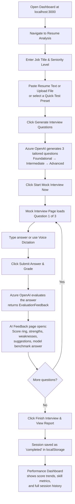

# AI Interview Preparation Platform

> **InterviewIQ** — Sharpen your technical interview skills with AI-generated questions, real-time mock sessions, and in-depth GPT-4.1-mini powered evaluations, all delivered through a premium dark-themed SaaS dashboard.

---


---

## Table of Contents

1. [Project Overview](#1-project-overview)
2. [Key Features](#2-key-features)
3. [Screenshots](#3-screenshots)
4. [Technology Stack](#4-technology-stack)
5. [System Architecture](#5-system-architecture)
6. [Project Folder Structure](#6-project-folder-structure)
7. [Installation and Setup](#7-installation-and-setup)
8. [Environment Configuration](#8-environment-configuration)
9. [Running the Application](#9-running-the-application)
10. [API Documentation](#10-api-documentation)
11. [Application Workflow](#11-application-workflow)
12. [Azure AI Integration](#12-azure-ai-integration)
13. [Security Considerations](#13-security-considerations)
14. [Troubleshooting](#14-troubleshooting)
15. [Future Enhancements](#15-future-enhancements)
16. [Contributing](#16-contributing)
17. [License and Attribution](#17-license-and-attribution)
18. [Author](#18-author)

---

## 1. Project Overview

The **AI Interview Preparation Platform** (branded **InterviewIQ**) is a full-stack web application that helps software engineering candidates prepare for technical interviews using real AI.

### What it does

- Accepts a candidate's resume text or a quick-start preset.
- Sends the resume to an Azure Functions backend, which forwards it to **Microsoft Azure OpenAI Service** (GPT-4.1-mini via Microsoft Foundry).
- Returns **three tailored technical interview questions** ranked by difficulty (Foundational → Intermediate → Advanced).
- Hosts a **mock interview session** where candidates answer each question via typed text or browser voice dictation.
- Submits each answer back to Azure OpenAI for comprehensive evaluation, returning a scored feedback report with strengths, weaknesses, improvement suggestions, and a model benchmark answer.
- Tracks **all sessions locally** in browser `localStorage` and aggregates performance metrics on a dedicated Performance dashboard.

### The problem it solves

Technical interview preparation is typically expensive (coaching sessions), generic (LeetCode-style questions unrelated to your actual experience), or unstructured (no feedback loop). This platform bridges that gap by generating questions _from your own resume_ and scoring _your own answers_ — turning preparation into a personalized feedback loop.

### Why AI-powered preparation matters

- Questions are grounded in the candidate's real technology stack, not generic patterns.
- AI feedback is immediate, detailed, and consistent — no waiting for a human coach.
- The evaluation covers technical accuracy, communication style, relevance, and provides an example answer to study.

---

## 2. Key Features

| Feature | Status | Description |
|---|---|---|
| Interactive Dashboard | ✅ Implemented | KPI cards, quick launch, preparation progress, recent activity |
| Resume Analysis | ✅ Implemented | Upload or paste resume; select job title and seniority level |
| AI-Generated Questions | ✅ Implemented | 3 tailored technical questions per session via Azure OpenAI |
| Mock Interview | ✅ Implemented | Per-question answer editor with word/char count and voice dictation |
| AI Answer Evaluation | ✅ Implemented | Full scorecard: score, relevance, tone, accuracy, strengths/weaknesses |
| Detailed AI Feedback | ✅ Implemented | Model benchmark answer, suggestions, and raw feedback stream |
| Performance Dashboard | ✅ Implemented | Score progression, skill metrics, full session history table |
| Interview History | ✅ Implemented | Persistent session storage in browser `localStorage`; JSON export |
| User Profile | ✅ Implemented | Compact profile modal (name, role, AI model, application) |
| Dark Theme | ✅ Implemented | Permanent dark navy theme throughout the application |
| Collapsible Sidebar | ✅ Implemented | Icon-only collapsed mode with tooltips, responsive mobile drawer |
| Dynamic Notifications | ✅ Implemented | Real-time bell badge driven by active session and evaluation state |
| Voice Dictation | ✅ Implemented | Web Speech API integration for microphone-based answers |
| Resume Presets | ✅ Implemented | Three one-click resume templates for instant testing |

---

## 3. Screenshots

> **Note:** Add actual screenshots to `docs/screenshots/` and update the paths below.

### Dashboard

```
docs/screenshots/dashboard.png
```

Replace with: ``

### Resume Analysis

```
docs/screenshots/resume-analysis.png
```

Replace with: ``

### Mock Interview

```
docs/screenshots/mock-interview.png
```

Replace with: ``

### AI Feedback

```
docs/screenshots/ai-feedback.png
```

Replace with: ``

### Performance Dashboard

```
docs/screenshots/performance.png
```

Replace with: ``

---

## 4. Technology Stack

### Frontend

| Technology | Version | Purpose |
|---|---|---|
| [Next.js](https://nextjs.org/) | 16.4.6 | React framework with App Router and Turbopack |
| [React](https://react.dev/) | 19.3.0 | UI rendering and component model |
| TypeScript | ^5 | Static typing throughout the frontend |
| [Tailwind CSS](https://tailwindcss.com/) | 4.3.3 | Utility-first CSS framework |
| @tailwindcss/turbopack | 4.3.3 | Tailwind loader for Turbopack dev server |
| [Lucide React](https://lucide.dev/) | ^1.73.0 | Icon library |
| Geist Font | via `next/font` | Sans-serif and mono typefaces |
| Web Speech API | Browser built-in | Voice dictation during mock interview |

### Backend (Azure Functions)

| Technology | Purpose |
|---|---|
| Azure Functions (v2) | Serverless HTTP trigger backend |
| Microsoft Azure OpenAI Service | LLM inference endpoint |
| GPT-4.1-mini (via Microsoft Foundry) | Question generation and answer evaluation model |

### Developer Tools

| Tool | Purpose |
|---|---|
| Azure Functions Core Tools (`func`) | Local Azure Functions runtime |
| ESLint + eslint-config-next | Linting |
| `@types/node`, `@types/react`, `@types/react-dom` | TypeScript type definitions |

---

## 5. System Architecture

### High-Level Overview

The frontend is a Next.js application running in the browser. It communicates with the Azure Functions backend over HTTP. The backend holds all AI credentials and proxies requests to the Azure OpenAI endpoint.

```mermaid
flowchart LR
    subgraph Browser["Browser (Next.js SPA)"]
        UI["Dashboard / Resume / Interview / Feedback / Performance Pages"]
        CTX["React Context\n(InterviewContext, SidebarContext)"]
        LS["localStorage\n(Session & Score Persistence)"]
        UI --> CTX
        CTX --> LS
    end

    subgraph Next["Next.js Server (Port 3000)"]
        PROXY["Rewrite Proxy\n/api/proxy/:path*"]
    end

    subgraph AF["Azure Functions Backend (Port 7071)"]
        GQ["POST /api/generateQuestions"]
        EA["POST /api/evaluateAnswer"]
    end

    subgraph AOI["Azure OpenAI Service\n(Microsoft Foundry)"]
        GPT["GPT-4.1-mini\nDeployment"]
    end

    UI -->|"Direct fetch or proxy fallback"| PROXY
    PROXY -->|rewrites| GQ
    PROXY -->|rewrites| EA
    UI -->|Direct fetch (primary)| GQ
    UI -->|Direct fetch (primary)| EA
    GQ --> GPT
    EA --> GPT
    GPT -->|JSON response| GQ
    GPT -->|JSON response| EA
    GQ -->|"{ questions: string[] }"| UI
    EA -->|"{ feedback: EvaluationFeedback }"| UI
```

### Request Flow

1. The user submits resume text and a job title on the **Resume Analysis** page.
2. The frontend calls `POST http://localhost:7071/api/generateQuestions` directly.
3. If a browser network or CORS error occurs, the client retries via the **Next.js rewrite proxy** at `/api/proxy/generateQuestions`, which is rewritten to the same Azure Functions URL server-side.
4. Azure Functions forwards the resume text to **Azure OpenAI (GPT-4.1-mini)** using the credentials stored only on the backend.
5. GPT-4.1-mini returns structured question text; the function parses and returns `{ questions: string[] }`.
6. The frontend stores the session in React context and `localStorage`.
7. During the mock interview, each submitted answer triggers `POST /api/evaluateAnswer`.
8. The evaluation response (`EvaluationFeedback`) is stored per-question in the session and rendered on the Feedback page.

---

## 6. Project Folder Structure

```
Azure PBL/                        ← Project root
│
├── frontend/                     ← Next.js frontend application
│   ├── public/
│   │   ├── images/               ← Static images (hero background, etc.)
│   │   └── logo.svg              ← Application logo
│   │
│   ├── src/
│   │   ├── app/                  ← Next.js App Router pages
│   │   │   ├── layout.tsx        ← Root layout (providers, metadata, fonts)
│   │   │   ├── globals.css       ← Global Tailwind and base styles
│   │   │   ├── page.tsx          ← Dashboard page (/)
│   │   │   ├── resume/
│   │   │   │   └── page.tsx      ← Resume Analysis page (/resume)
│   │   │   ├── interview/
│   │   │   │   └── page.tsx      ← Mock Interview page (/interview)
│   │   │   ├── feedback/
│   │   │   │   └── page.tsx      ← AI Feedback page (/feedback)
│   │   │   └── performance/
│   │   │       └── page.tsx      ← Performance Dashboard (/performance)
│   │   │
│   │   ├── components/
│   │   │   ├── layout/
│   │   │   │   ├── AppLayout.tsx ← Root shell: Sidebar + Header + main content
│   │   │   │   ├── Sidebar.tsx   ← Collapsible vertical navigation sidebar
│   │   │   │   └── Header.tsx    ← Sticky top bar: notifications, user profile
│   │   │   └── ui/
│   │   │       ├── Badge.tsx     ← Status badge component
│   │   │       ├── Button.tsx    ← Button with loading and icon slots
│   │   │       ├── Card.tsx      ← Card, CardHeader, CardContent, etc.
│   │   │       ├── Logo.tsx      ← Application logo component
│   │   │       └── Progress.tsx  ← Progress bar component
│   │   │
│   │   ├── context/
│   │   │   ├── InterviewContext.tsx ← Session lifecycle, answers, evaluations
│   │   │   ├── SidebarContext.tsx   ← Sidebar collapse/mobile state
│   │   │   └── ThemeContext.tsx     ← Dark theme enforcement
│   │   │
│   │   ├── lib/
│   │   │   ├── api.ts            ← generateQuestions() and evaluateAnswer() with proxy fallback
│   │   │   ├── storage.ts        ← localStorage read/write helpers and stats computation
│   │   │   └── utils.ts          ← Text cleaning, score extraction, date formatting
│   │   │
│   │   └── types/
│   │       └── interview.ts      ← TypeScript interfaces: EvaluationFeedback, InterviewSession, etc.
│   │
│   ├── .env.local                ← Local environment variables (not committed)
│   ├── .env.example              ← Environment variable template (committed)
│   ├── next.config.ts            ← Next.js config with Turbopack and proxy rewrite
│   ├── package.json              ← Frontend dependencies and npm scripts
│   └── tsconfig.json             ← TypeScript configuration
│
└── README.md                     ← This file
```

> **Note:** The Azure Functions backend files (containing function implementations, `host.json`, `local.settings.json`, and AI credentials) reside separately. The frontend communicates with the backend over HTTP and does **not** include any backend source in this directory.

---

## 7. Installation and Setup

### Prerequisites

Install the following tools before proceeding:

| Tool | Download | Notes |
|---|---|---|
| Node.js | https://nodejs.org/ | v18 or later recommended |
| npm | Included with Node.js | v9 or later |
| Azure Functions Core Tools | https://learn.microsoft.com/en-us/azure/azure-functions/functions-run-local | v4 for running functions locally |
| Visual Studio Code | https://code.visualstudio.com/ | Recommended editor |
| Azure OpenAI access | https://portal.azure.com/ | Requires an Azure subscription with OpenAI resource |

### Clone the Repository

```bash
git clone YOUR_REPOSITORY_URL
cd "Azure PBL"
```

Replace `YOUR_REPOSITORY_URL` with your actual repository URL.

### Install Frontend Dependencies

```bash
cd frontend
npm install
```

---

## 8. Environment Configuration

### Frontend — `.env.local`

The frontend requires one environment variable to locate the Azure Functions backend.

1. Copy the example file:

```bash
# From the frontend/ directory
copy .env.example .env.local
```

2. Edit `.env.local`:

```env
# Point this to your running Azure Functions instance.
# Local development (default):
NEXT_PUBLIC_API_BASE_URL=http://localhost:7071

# Azure-deployed backend:
# NEXT_PUBLIC_API_BASE_URL=https://your-function-app.azurewebsites.net
```

> [!IMPORTANT]
> `NEXT_PUBLIC_API_BASE_URL` must use the `NEXT_PUBLIC_` prefix so that Next.js exposes it to the browser bundle. Without it, all API calls will fall back to `http://localhost:7071`.

### Backend — `local.settings.json`

The Azure Functions backend (not included in the frontend repository) requires a `local.settings.json` file at its root. Create it with the following structure:

```json
{
  "IsEncrypted": false,
  "Values": {
    "AzureWebJobsStorage": "UseDevelopmentStorage=true",
    "FUNCTIONS_WORKER_RUNTIME": "python",
    "AZURE_OPENAI_API_KEY": "your_azure_openai_api_key",
    "AZURE_OPENAI_ENDPOINT": "https://your-resource.openai.azure.com/",
    "AZURE_OPENAI_DEPLOYMENT_ID": "your_deployment_name"
  },
  "Host": {
    "LocalHttpPort": 7071,
    "CORS": "*"
  }
}
```

> [!CAUTION]
> Never commit `local.settings.json` to version control. It contains your Azure API credentials. Add it to `.gitignore` immediately.

**Required backend environment variables:**

| Variable | Description |
|---|---|
| `AZURE_OPENAI_API_KEY` | API key from your Azure OpenAI resource |
| `AZURE_OPENAI_ENDPOINT` | Endpoint URL, e.g. `https://your-resource.openai.azure.com/` |
| `AZURE_OPENAI_DEPLOYMENT_ID` | The deployed model name, e.g. `gpt-4.1-mini` |

---

## 9. Running the Application

You need **two terminals** running simultaneously: one for the backend, one for the frontend.

### Terminal 1 — Start the Azure Functions Backend

Navigate to the directory containing your Azure Functions source code and run:

```bash
func start
```

The backend will start on `http://localhost:7071`. You should see output confirming the two HTTP triggers are registered:

```
Functions:
  generateQuestions: [POST] http://localhost:7071/api/generateQuestions
  evaluateAnswer:    [POST] http://localhost:7071/api/evaluateAnswer
```

### Terminal 2 — Start the Next.js Frontend

```bash
cd frontend
npm run dev
```

The frontend will start on `http://localhost:3000`.

Open your browser and navigate to: **http://localhost:3000**

### Production Build

To verify the application builds without errors before deploying:

```bash
cd frontend
npm run build
```

A successful build outputs static files to `frontend/.next/`.

---

## 10. API Documentation

The Azure Functions backend exposes two HTTP POST endpoints.

---

### `POST /api/generateQuestions`

Generates three tailored technical interview questions based on a resume and job title.

**Request**

```http
POST http://localhost:7071/api/generateQuestions
Content-Type: application/json
```

```json
{
  "resumeText": "Target Job Title: Senior Azure Python Developer (Mid-Senior Level)\n\nCandidate Resume / Experience:\nSenior Backend Developer with 5 years experience specializing in Python, FastAPI, and Azure Functions..."
}
```

| Field | Type | Required | Description |
|---|---|---|---|
| `resumeText` | `string` | Yes | Combined prompt containing job title, seniority, and resume content |

**Success Response** — `200 OK`

```json
{
  "questions": [
    "How would you design a scalable Python-based microservice using Azure Functions and Cosmos DB to handle unpredictable API traffic?",
    "Explain your approach to implementing distributed tracing in a FastAPI service deployed on Azure Container Apps.",
    "What strategies would you use to optimize cold-start latency in Azure Functions running Python workloads?"
  ]
}
```

**Error Response** — `400 / 500`

```json
{
  "error": "Description of the error"
}
```

---

### `POST /api/evaluateAnswer`

Submits a candidate's answer to a technical question and returns a comprehensive AI evaluation.

**Request**

```http
POST http://localhost:7071/api/evaluateAnswer
Content-Type: application/json
```

```json
{
  "question": "How would you design a scalable serverless architecture on Azure using Azure Functions and Cosmos DB to handle unpredictable traffic spikes?",
  "answer": "I would use Azure Functions with a consumption plan to auto-scale based on demand. Cosmos DB with autoscale RUs would handle the data layer..."
}
```

| Field | Type | Required | Description |
|---|---|---|---|
| `question` | `string` | Yes | The interview question text |
| `answer` | `string` | Yes | The candidate's answer text |

**Success Response** — `200 OK`

```json
{
  "feedback": {
    "score": "7.5/10",
    "relevance": "The answer directly addresses the core architectural requirements.",
    "tone": "Professional and structured. Demonstrates seniority through confident phrasing.",
    "technicalAccuracy": "Correctly identifies Azure Functions consumption plan and Cosmos DB autoscale. Missing discussion of event-driven triggers and retry policies.",
    "strengths": "Clear identification of serverless compute and auto-scaling database. Mentions cost efficiency of consumption plan.",
    "weaknesses": "No mention of Azure Service Bus for message buffering, circuit-breaker patterns, or cold-start mitigation strategies.",
    "suggestions": "1. Discuss Azure Service Bus as a buffer during traffic spikes.\n2. Address cold-start latency with Premium plan or pre-warming.\n3. Mention Cosmos DB change feed for event-driven processing.",
    "improvedAnswer": "To design a scalable serverless architecture on Azure...",
    "fullFeedback": "Complete multi-line feedback stream from the AI model..."
  }
}
```

**Error Response** — `400 / 500`

```json
{
  "error": "Description of the error"
}
```

---

### Proxy Fallback

The frontend's `lib/api.ts` implements an automatic fallback mechanism:

1. **Primary:** Direct `fetch` to `http://localhost:7071/api/<endpoint>`.
2. **Fallback:** If a network/CORS error occurs, retries via the Next.js rewrite proxy at `/api/proxy/<endpoint>`, which is rewritten server-side to the same Azure Functions URL.

This ensures the application works even when browser CORS restrictions block direct calls to `localhost:7071`.

---

## 11. Application Workflow



---

## 12. Azure AI Integration

### Microsoft Azure OpenAI Service

The backend Azure Functions integrate with **Azure OpenAI Service** provisioned through **Microsoft Azure AI Foundry**. The deployed model is **GPT-4.1-mini**.

**Question Generation (`/api/generateQuestions`)**

The function receives the candidate's resume and job title, constructs a system-level prompt instructing GPT-4.1-mini to act as a senior technical interviewer, and requests exactly three questions ranked by difficulty. The response is parsed and returned as a JSON array.

**Answer Evaluation (`/api/evaluateAnswer`)**

The function receives the question and the candidate's answer, then sends a structured evaluation prompt to GPT-4.1-mini. The model returns a detailed assessment covering:

- Numerical score (0–10)
- Technical accuracy
- Answer relevance to the question
- Communication tone and structure
- Strengths and weaknesses
- Actionable improvement suggestions
- A complete model benchmark answer

**Security of AI Credentials**

All API keys and endpoint URLs are stored exclusively in the backend (`local.settings.json` locally, Azure Application Settings in production). The frontend **never** handles or exposes these credentials — it only sends resume text and answers to the Azure Functions URLs.

---

## 13. Security Considerations

> [!CAUTION]
> Follow these practices to avoid exposing credentials or introducing vulnerabilities.

- **Never commit `local.settings.json`** — add it to `.gitignore` immediately after creation.
- **Never commit `.env.local`** — the `.gitignore` generated by `create-next-app` excludes it by default; verify this.
- **Do not expose AI credentials in the frontend** — all Azure OpenAI keys live only in the backend.
- **Validate inputs on the backend** — sanitize `resumeText`, `question`, and `answer` fields before forwarding to Azure OpenAI to prevent prompt injection.
- **Use HTTPS in production** — configure HTTPS on both the Next.js deployment and the Azure Function App.
- **Restrict CORS in production** — tighten the CORS policy in `local.settings.json` from `"*"` to your deployed frontend domain.
- **Rotate keys regularly** — regenerate Azure OpenAI API keys if they are accidentally exposed.
- **Protect Azure Function endpoints** — consider enabling Azure Function-level authentication keys or Azure API Management for production deployments.

---

## 14. Troubleshooting

### Azure Functions not starting

**Symptom:** `func start` fails or exits immediately.

**Solutions:**
- Verify Azure Functions Core Tools are installed: `func --version`
- Ensure you are running `func start` from the directory that contains `host.json`.
- Check that the correct Python version is installed and active if using a Python worker.
- Confirm `local.settings.json` exists and contains all required values.

---

### Frontend not connecting to the backend

**Symptom:** "Unable to connect to Azure Function at http://localhost:7071/api/generateQuestions" error in the UI.

**Solutions:**
- Confirm Azure Functions is running: visit `http://localhost:7071/api/generateQuestions` in your browser (expect a method-not-allowed, not a connection error).
- Check `.env.local` exists in the `frontend/` directory and contains `NEXT_PUBLIC_API_BASE_URL=http://localhost:7071`.
- Restart `npm run dev` after editing `.env.local`.
- Verify no firewall or antivirus is blocking port 7071.

---

### Missing environment variables

**Symptom:** Questions generate but return an error, or no AI response is received.

**Solutions:**
- Open `local.settings.json` on the backend and confirm `AZURE_OPENAI_API_KEY`, `AZURE_OPENAI_ENDPOINT`, and `AZURE_OPENAI_DEPLOYMENT_ID` are populated with correct values.
- Verify the deployment name exactly matches what is listed in Azure AI Foundry.

---

### Azure OpenAI authentication errors (401 / 403)

**Symptom:** Backend logs show `401 Unauthorized` or `403 Forbidden`.

**Solutions:**
- Regenerate the API key in the Azure portal and update `local.settings.json`.
- Confirm the endpoint URL ends with `/` and matches the region of your Azure OpenAI resource.
- Ensure your Azure subscription has an approved quota for GPT-4.1-mini.

---

### npm installation errors

**Symptom:** `npm install` fails with `ERESOLVE` or `ENOENT`.

**Solutions:**
- Use Node.js v18 or later: `node --version`
- Clear the npm cache: `npm cache clean --force`
- Delete `node_modules` and `package-lock.json`, then re-run `npm install`.

---

### Port conflicts

**Symptom:** `address already in use` on port 3000 or 7071.

**Solutions:**
- Kill the process occupying the port:
  ```bash
  # Windows — find and kill process on port 3000
  netstat -ano | findstr :3000
  taskkill /PID <PID> /F
  ```
- Or change the frontend port: `npm run dev -- -p 3001`

---

### Session data not persisting between page refreshes

**Symptom:** Interview history disappears on refresh.

**Solutions:**
- Confirm the browser is not in private/incognito mode (localStorage is cleared on session end in incognito).
- Check that the browser's storage quota is not exceeded.
- Inspect the browser DevTools → Application → Local Storage for keys beginning with `ai_career_coach_`.

---

## 15. Future Enhancements

The following improvements are **planned but not yet implemented**:

- **Cloud Session Persistence** — Replace `localStorage` with Azure Cosmos DB or Azure SQL to synchronize sessions across devices and browsers.
- **Multi-round Interview Mode** — Support 5–10 question sessions with configurable question counts.
- **Resume PDF Parsing** — Extract plain text from uploaded PDF files server-side, beyond the current browser `FileReader` text extraction.
- **Difficulty Customization** — Allow candidates to request more Foundational, Intermediate, or Advanced questions on demand.
- **Comparative Analytics** — Visualize score deltas between sessions and highlight improving or declining skill areas.
- **Interview Timer** — Enforce per-question time limits to simulate real interview conditions.
- **Team / Cohort Mode** — Allow training cohorts to share question banks and compare aggregate scores.
- **Multilingual Support** — Generate questions and evaluate answers in languages other than English.
- **Azure AD Authentication** — Secure the platform with Microsoft identity for enterprise use.

---

## 16. Contributing

Contributions are welcome. Please follow these steps:

1. **Fork** the repository on GitHub.

2. **Clone** your fork locally:
   ```bash
   git clone https://github.com/YOUR_USERNAME/REPO_NAME.git
   cd "Azure PBL"
   ```

3. **Create a feature branch** from `main`:
   ```bash
   git checkout -b feature/your-feature-name
   ```

4. **Make your changes.** Follow existing code style (TypeScript, Tailwind, functional React components).

5. **Build and verify** before committing:
   ```bash
   cd frontend
   npm run build
   ```

6. **Commit** with a descriptive message:
   ```bash
   git add .
   git commit -m "feat: add PDF resume parsing to Resume Analysis page"
   ```

7. **Push** to your fork:
   ```bash
   git push origin feature/your-feature-name
   ```

8. **Open a Pull Request** on GitHub targeting the `main` branch. Describe what your change does and reference any relevant issue.

### Code Style Guidelines

- All new components must be written in TypeScript.
- Use Tailwind CSS utility classes; avoid inline `style` props unless necessary.
- Keep Azure credentials out of all frontend files.
- Do not modify `host.json` or `local.settings.json`.

---

## 17. License and Attribution

This project does not currently include a software license file. All rights are reserved by the project author unless otherwise stated.

**Third-party attributions:**

| Library | License |
|---|---|
| Next.js | MIT |
| React | MIT |
| Tailwind CSS | MIT |
| Lucide React | ISC |
| Geist Font | SIL Open Font License |

If you reuse or fork this project, retain all copyright notices and third-party attributions. Do not remove any existing license headers from dependency packages.

---

## 18. Author

| Field | Value |
|---|---|
| Developer | Preetham |
| GitHub | _Add your GitHub profile URL here_ |
| Repository | _Add your repository URL here_ |
| Project | AI Interview Preparation Platform (InterviewIQ) |

---

> Built with Next.js 16, React 19, Tailwind CSS 4, Azure Functions, and GPT-4.1-mini via Microsoft Azure AI Foundry.
